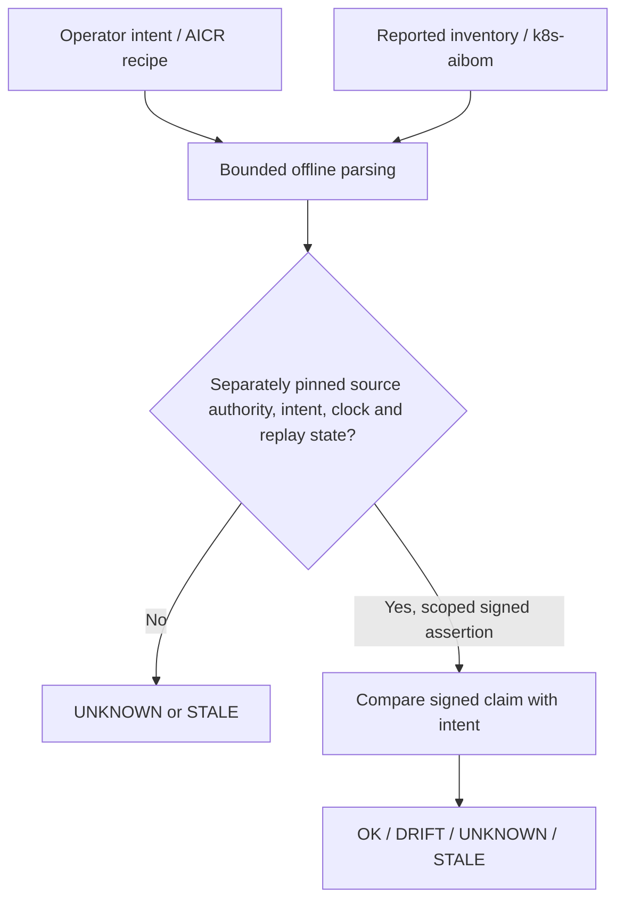

<div align="center">

# Runtime Assurance Lab

**AI workload intent, observations and evidence trust — tested offline.**

[](https://github.com/ZX7-Labs/runtime-assurance-lab/actions/workflows/offline-assurance.yml)
[](LICENSE)
[](pyproject.toml)

**[Get started](#get-started)** · **[Find a task](#contribute-without-a-gpu)** · [Evidence and limits](docs/CLAIMS_AND_BASELINES.md) · [Architecture](docs/ARCHITECTURE.md)

</div>

> [!IMPORTANT]
> **Research prototype — not production assurance.** The current decision is `PAUSE_PRODUCT_BUILD`. Real GPU/model execution and any additional security benefit beyond existing NVIDIA AICR + Google k8s-aibom + signing/policy tooling have **not** been demonstrated.

## What question are we testing?

A deployment recipe describes **what should run**. An inventory report describes **what a collector claims it saw**. A valid signature authenticates **a source assertion**, not whether that source told the truth.

**Can an additional, independently trusted comparison reveal meaningful AI workload drift that existing tools, used together on the same evidence, would miss?**

We do not know yet. This repository makes the question **reproducible and falsifiable** rather than presenting synthetic passing tests as GPU assurance.

| Available today | Not established |
| --- | --- |
| Offline Python contracts and strict JSON parsing | A live Kubernetes/GPU monitoring service |
| Research adapters for AICR RecipeResult and k8s-aibom | Actual model execution on a GPU |
| Scoped Ed25519 signed-claim, replay and tamper tests | Independent production trust/rollback custody |
| CPU-only synthetic tests and recorded upstream research | A verified advantage over existing tools or customer demand |

## Get started

**No GPU, Kubernetes cluster, Docker or credentials needed.** With Python 3.11+:

```bash
git clone https://github.com/ZX7-Labs/runtime-assurance-lab.git
cd runtime-assurance-lab
python -m pip install -e ".[test]"
python -m pytest -q
```

Generate and check an entirely **synthetic** signed journal:

```bash
ral demo --fixtures fixtures --output results/demo
ral verify --journal results/demo/journal.json --trust results/demo/trust-public.json --checkpoint results/demo/checkpoint.json
```

**Caution:** the demo creates its own keys and checkpoint in the ignored `results/demo/` folder. Its verification demonstrates internal consistency only, **not** independent authenticity or actual runtime state.

See why a complete-looking unsigned observation cannot pass:

```bash
ral evaluate --intent fixtures/intent.json --observation fixtures/clean.json --now 2026-11-12T03:25:00Z
```

Expected: `UNKNOWN`, **exit code 2**. This is correct fail-closed behavior, not a failed installation. For virtual environments, PowerShell, exact exit codes and troubleshooting, use the [cross-platform reproduction guide](docs/REPRODUCIBILITY.md). `ral --help` lists additional offline experiments.

## How the trust boundary works



The ordinary `evaluate` path does **not** authenticate its observation, so even apparent matches and mismatches stay `UNKNOWN`. The separately scoped `evaluate-authenticated` experiment checks signatures **only against external trust and sequence pins**; a dishonest authorized signer can still lie. The local SQLite checkpoint is not an independently operated rollback authority.

[Read the architecture and threat model](docs/ARCHITECTURE.md) · [Read the security review](SECURITY_REVIEW.md)

## Contribute without a GPU

We welcome improvements that **disprove** the need for another product as well as ones that support it. Pick a small, independently checkable task:

| Background | Reviewable first task |
| --- | --- |
| New Python contributor | [#1 — reproduce the quickstart on macOS/Windows](https://github.com/ZX7-Labs/runtime-assurance-lab/issues/1) |
| Python packaging | [#5 — independently test wheel/sdist installation](https://github.com/ZX7-Labs/runtime-assurance-lab/issues/5) |
| Metrics and methodology | [#6 — audit benchmark claims and denominators](https://github.com/ZX7-Labs/runtime-assurance-lab/issues/6) |
| Kubernetes / GPU research | [#2 — test a fair NVIDIA/Google upstream comparison](https://github.com/ZX7-Labs/runtime-assurance-lab/issues/2) |
| AppSec / provenance | [#3 — review signed-claim and replay boundaries](https://github.com/ZX7-Labs/runtime-assurance-lab/issues/3) |

Potential independently authorized G4 research partners: [issue #4](https://github.com/ZX7-Labs/runtime-assurance-lab/issues/4). **Do not upload live workload exports, credentials or private evidence to public issues.**

[Contributor guide](docs/CONTRIBUTOR_PATHS.md) · [CONTRIBUTING.md](CONTRIBUTING.md) · [Independent verification challenge](research/INDEPENDENT_REVIEW_CHALLENGE.md) · [Private security reporting guidance](SECURITY.md)

## Evidence, limits and next decision

- **Tested:** offline contracts, synthetic adversarial cases, hosted Python 3.11/3.13 checks, stored research-gate replay and certain pinned vendor-native **CPU** commands. [Exact evidence](EVIDENCE.md).
- **Not tested:** real same-workload AICR ↔ AIBOM independent provenance, live GPU execution, production collection-to-verdict latency, externally protected antirollback or customer demand.
- **Critical negative control:** a historical **600-case synthetic same-input** reference reported **zero disagreements**; it did not demonstrate incremental value. A deliberately weak naive comparator is **not** an NVIDIA/Google baseline. [Metrics, denominators and limitations](docs/CLAIMS_AND_BASELINES.md).
- **Next scientific gate:** a blinded, independently authenticated, *same-workload* comparison against the **strongest existing upstream composition**. If upstream already covers the need, contribute upstream instead of duplicating a product. [G4 protocol](research/g4_independent_validation_protocol.md) · [Research roadmap](docs/ROADMAP.md) · [Upstream audit](UPSTREAM_AUDIT.md).

This is independently maintained open-source research, **not affiliated with or endorsed by NVIDIA, Google or Sigstore**.

## Repository guide

| Where | What's inside |
| --- | --- |
| [`src/runtime_assurance_lab/`](src/runtime_assurance_lab/) | Offline evaluator, adapters, provenance and replay |
| [`tests/`](tests/) + [`fixtures/`](fixtures/) | Synthetic and adversarial checks |
| [`scripts/`](scripts/) + [`results/`](results/) | Reproduction commands and **historical** metrics |
| [`research/`](research/) | Experimental protocols and operator handoff |
| [`PLAN.md`](PLAN.md) · [`DECISIONS.md`](DECISIONS.md) · [`EVIDENCE.md`](EVIDENCE.md) | Research decisions, implementation context and evidence |

**License:** [Apache-2.0](LICENSE) · [NOTICE](NOTICE) · [Support](SUPPORT.md) · [Governance](GOVERNANCE.md)

*The honest outcome of research may be that another product should not be built.*
